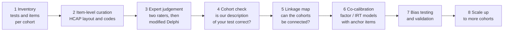

# COSMIC cognitive harmonisation

Methods, documentation and working files for putting cognitive test data from **COSMIC** cohorts (Cohort Studies of Memory in an International Consortium) on a common scale, using the **Harmonized Cognitive Assessment Protocol (HCAP)** as the reference framework.

**Project home:** Centre for Healthy Brain Ageing (CHeBA), UNSW Sydney
**Status (15 Nov 2026):** item-level curation of six pilot cohorts is drafted; the expert questionnaire is built and about to be piloted. No statistical harmonisation has been run yet.

> This repository holds metadata and methods only. It contains **no participant-level data**.

## The problem

COSMIC cohorts used different cognitive tests, in different languages, given and scored in different ways. Scores cannot be compared across cohorts until we know which tests measure the same thing and which are similar enough to link the cohorts together.

## Approach

We follow the method HCAP used to harmonise six national studies (Gross et al., 2023; Briceño et al., 2023), adapted for cohorts that did not share a protocol.



Three principles run through all of it:

1. **The unit is the test as it was given in a particular cohort**, not the test's name. Language, materials, timing and scoring all matter.
2. **What a test measures and whether it can link cohorts are separate questions.** Two memory tests can both measure memory and still be too different to link.
3. **Expert judgement proposes; statistics test.** Experts classify links as confident, tentative or none. Tentative links are tested for bias before they are used.

The full reasoning is in [`documentation/harmonisation_strategy.md`](documentation/harmonisation_strategy.md).

## Where things stand

| Stage | Status |
|---|---|
| 1. Inventory | Done for six pilot cohorts (variable names and labels only) |
| 2. Item-level curation | Draft v0.2: 154 rows, 95 item codes, every source variable checked against the cohort files |
| 3. Expert judgement | Questionnaire built in REDCap (18 test cards); protocol drafted; pilot run and panel invitations pending |
| 4. Cohort check | Not started |
| 5 to 8 | Not started |

**Pilot cohorts:** MYHAT (USA), HELIAD (Greece), KLOSCAD (South Korea), MYNAH (India), SPAH (Brazil) and the Uganda study. They were chosen because their data are in hand and together they cover six regions.

Decisions, their dates and what they replaced are recorded in [`Harmonisation Decision Log.Rmd`](Harmonisation%20Decision%20Log.Rmd).

## What is in this repository

| Path | Contents |
|---|---|
| `Harmonisation Decision Log.Rmd` | Dated record of every methodological decision, including strategies that were tried and dropped |
| `documentation/harmonisation_strategy.md` | The current strategy and the evidence behind it |
| `documentation/delphi_protocol.md` | Draft protocol for the modified Delphi: panel, questions, consensus rules |
| `documentation/item_mapping_conventions.md` | How items are coded in the mapping workbook |
| `documentation/archive/` | Superseded strategy documents and meeting notes, kept for the record |
| `curation/COSMIC_Item_Mapping_Pilot_v0.2.xlsx` | Item-level mapping of the six pilot cohorts, in HCAP's layout |
| `curation/build_item_mapping.py` | Script that generates the workbook; mapping decisions are edited here |
| `delphi/cards.py` | The 18 test descriptions ("reference panels") and answer options: the single source for the questionnaire |
| `delphi/build_redcap.py` | Generates the REDCap data dictionary and the preview page |
| `delphi/COSMIC_Delphi_R1_REDCap_DataDictionary_v2.csv` | Import file for REDCap |
| `delphi/rater_preview.html` | What a panel member sees (download and open in a browser) |
| `cohort_tracking/Cohort review.xlsx` | Cohort review and data request tracker (last updated early Nov 2026) |
| `presentations/` | Webinar and meeting slides |

## Rebuilding the files

```bash
pip install openpyxl

# Delphi questionnaire: REDCap dictionary + preview page
python delphi/build_redcap.py

# Item-mapping workbook
python curation/build_item_mapping.py
```

The mapping script reads item labels and domains from the HCAP Prestatistical Harmonization Resource. That workbook was shared with the project by the HCAP team and is not public, so it is not in this repository. Place it at `private/HCAP_Prestatistical_Harmonization_Resource.xlsx` (the `private/` folder is git-ignored) or set the `HCAP_RESOURCE` environment variable.

To knit the decision log: open `Harmonisation Decision Log.Rmd` in RStudio and click **Knit** (needs `rmarkdown`).

## Data governance

- No participant-level data is stored here, and none should be added. Cohort data stay in UNSW-approved storage under each cohort's data access agreement.
- The mapping workbook records variable names and labels only.
- Test content under copyright (word lists, story text, stimuli) is not reproduced anywhere in this repository.

## References

- Gross AL, Li C, Briceño EM, Arce Rentería M, et al. Harmonisation of later-life cognitive function across national contexts: results from the Harmonized Cognitive Assessment Protocols. *Lancet Healthy Longevity* 2023;4(10):e573–e583. doi:10.1016/S2666-7568(23)00170-8
- Briceño EM, Arce Rentería M, Gross AL, Jones RN, et al. A cultural neuropsychological approach to harmonization of cognitive data across culturally and linguistically diverse older adult populations. *Neuropsychology* 2023;37(3):247–257. doi:10.1037/neu0000816

## Contact

James Lian, PhD · CHeBA, UNSW Sydney · j.lian@unsw.edu.au
